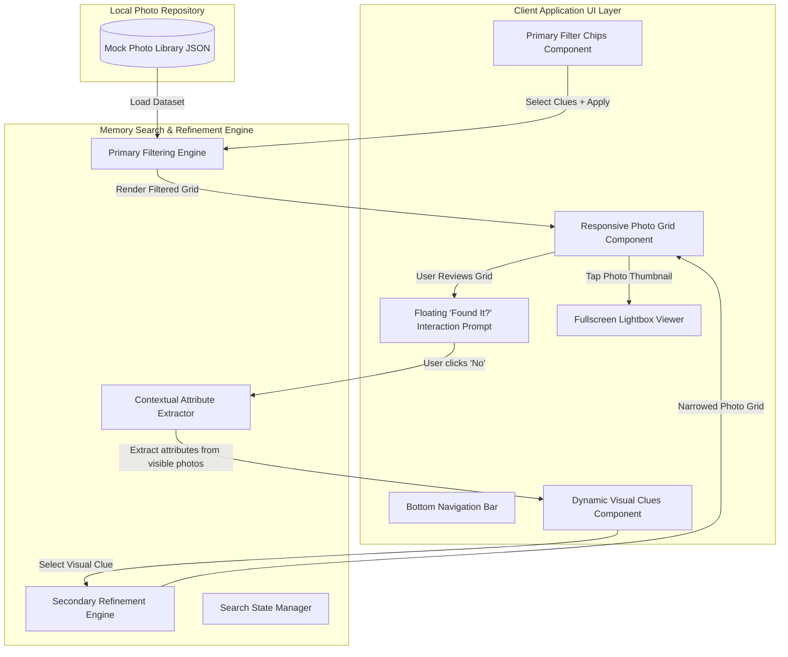
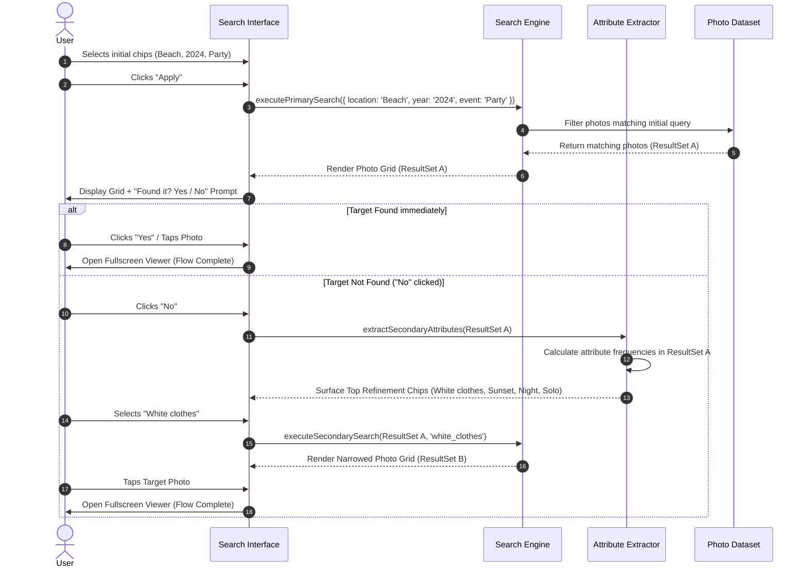
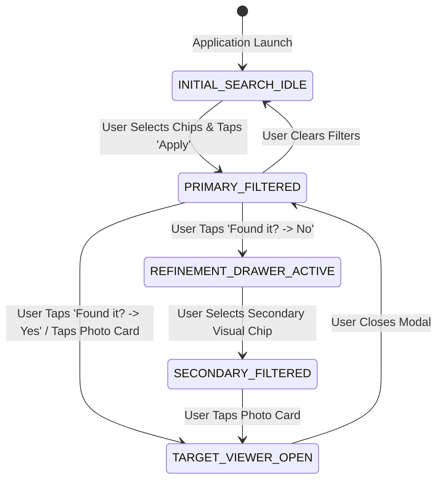

# System Architecture: AI-Assisted Google Photos Search MVP

## 1. System Overview & Component Diagram

The **AI-Assisted Photo Search MVP** is designed as a lightweight, client-side progressive web application that simulates a smart, context-aware memory discovery engine. It translates vague human memory clues into structured data queries and dynamically surfaces secondary visual attributes when initial searches require refinement.

### High-Level Component Architecture



---

## 2. Component Specifications

### 2.1 UI Component Tree & Responsibilities

```
App Root Container
├── Header & Search Bar
├── Primary Memory Chips Bar (Event, Location, Date, People)
├── Action Bar (Apply CTA / Active Filters Counter)
├── Photo Grid Container
│   └── Photo Card (Thumbnail, Tags preview, OnClick trigger)
├── Floating Refinement Bar ("Found it? Yes / No")
├── Secondary Visual Chips Drawer (Renders on "No" trigger)
└── Fullscreen Lightbox Modal (Full-res image, Metadata panel, Close CTA)
```

#### Detailed Component Responsibilities
1. **Primary Filter Chips Component:** Renders categorized memory chips (`Event/Vibe`, `Location`, `Date/Year`, `People`). Handles multi-selection toggle states.
2. **Photo Grid Component:** Displays a responsive masonry/CSS Grid view of matching photos. Implements lazy loading and empty state handling.
3. **Floating Refinement Prompt Component:** Appears fixed at the bottom once initial search results are displayed. Solicits binary user feedback (`"Found it?" -> Yes / No`).
4. **Dynamic Visual Clues Component:** Slides up when `"No"` is selected. Displays dynamically generated secondary visual chips (e.g., `White clothes`, `Sunset`, `Solo photo`).
5. **Fullscreen Lightbox Viewer:** Opens when a target photo thumbnail is clicked, displaying the high-res photo, metadata tags, and completing the user happy path.

---

## 3. Data Architecture & Schema Specification

### 3.1 Data Model (`PhotoRecord`)

Every photo record in the system contains primary indexing metadata as well as secondary visual attributes used during refinement.

```json
{
  "$schema": "http://json-schema.org/draft-07/schema#",
  "title": "PhotoRecord",
  "type": "object",
  "properties": {
    "photo_id": { "type": "string" },
    "title": { "type": "string" },
    "image_url": { "type": "string" },
    "date": { "type": "string", "format": "date" },
    "year": { "type": "string" },
    "location": { "type": "string" },
    "event": { "type": "string" },
    "people": { 
      "type": "array", 
      "items": { "type": "string" } 
    },
    "visual_attributes": { 
      "type": "array", 
      "items": { "type": "string" } 
    },
    "aspect_ratio": { "type": "string", "enum": ["square", "portrait", "landscape"] }
  },
  "required": ["photo_id", "image_url", "year", "location", "event", "people", "visual_attributes"]
}
```

### 3.2 Mock Data Seed Example

```javascript
export const mockPhotos = [
  {
    photo_id: "photo_01",
    title: "Goa Sunset Party",
    image_url: "https://images.unsplash.com/photo-1507525428034-b723cf961d3e",
    date: "2024-06-12",
    year: "2024",
    location: "Goa Beach",
    event: "Party",
    people: ["Alex", "Sam"],
    visual_attributes: ["white_clothes", "sunset", "outdoor", "group"],
    aspect_ratio: "landscape"
  },
  {
    photo_id: "photo_02",
    title: "Beach Bonfire Night",
    image_url: "https://images.unsplash.com/photo-1519046904884-53103b34b206",
    date: "2024-06-12",
    year: "2024",
    location: "Goa Beach",
    event: "Party",
    people: ["Alex"],
    visual_attributes: ["dark", "night", "bonfire", "solo"],
    aspect_ratio: "portrait"
  }
];
```

---

## 4. Search & Dynamic Refinement Engine Logic

### 4.1 Step-by-Step Execution Sequence



### 4.2 Algorithm Definitions

#### Algorithm 1: Primary Search Filter
$$\text{ResultSet}_A = \{ p \in \text{Dataset} \mid \text{matches}(p, \text{PrimaryFilters}) \}$$
A photo $p$ matches if all selected category criteria (Location, Year, Event, People) intersect with $p$'s attributes.

#### Algorithm 2: Contextual Attribute Extraction
When the user clicks `"No"`, the system computes secondary visual attribute candidates from $\text{ResultSet}_A$:
1. Extract set of all `visual_attributes` from photos in $\text{ResultSet}_A$.
2. Exclude attributes already selected in primary/secondary filters.
3. Frequency rank attributes: $\text{Freq}(a) = \sum_{p \in \text{ResultSet}_A} \mathbb{I}(a \in p.\text{visual\_attributes})$.
4. Surface top 4–6 most frequent visual chips to the UI.

#### Algorithm 3: Secondary Sub-Filtering
$$\text{ResultSet}_B = \{ p \in \text{ResultSet}_A \mid \text{SelectedVisualClue} \in p.\text{visual\_attributes} \}$$

---

## 5. Application State Machine

The interface operates under a strictly controlled state machine to ensure predictable UI rendering and smooth transitions:



### State Store Structure
```typescript
interface AppState {
  allPhotos: PhotoRecord[];
  selectedInitialChips: {
    location?: string;
    year?: string;
    event?: string;
    people?: string[];
  };
  activeFilteredPhotos: PhotoRecord[];
  refinementStatus: 'IDLE' | 'PRIMARY_ACTIVE' | 'NEEDS_REFINEMENT' | 'REFINED';
  availableSecondaryChips: string[];
  selectedSecondaryChip: string | null;
  activePhotoModal: PhotoRecord | null;
}
```

---

## 6. Directory & File Layout Plan

```
google-photos-search-mvp/
├── docs/
│   ├── problemStatement.md
│   ├── context.md
│   └── Architecture.md
├── index.html
├── package.json
├── src/
│   ├── css/
│   │   ├── main.css
│   │   ├── components.css
│   │   └── lightbox.css
│   ├── data/
│   │   └── mockPhotos.js
│   ├── js/
│   │   ├── engine/
│   │   │   ├── searchEngine.js
│   │   │   └── attributeExtractor.js
│   │   ├── components/
│   │   │   ├── filterChips.js
│   │   │   ├── photoGrid.js
│   │   │   ├── refinementPrompt.js
│   │   │   └── lightbox.js
│   │   └── app.js
└── README.md
```

---

## 7. Known Architectural Limitations & Future Scalability

| Dimension | MVP Prototype Architecture | Production Architecture Target |
| :--- | :--- | :--- |
| **Data Source** | Local JSON mock dataset (~20-50 photos) | Cloud Media API / Google Photos Library API |
| **Image Tagging** | Pre-annotated metadata tags | Multimodal AI Model (e.g., CLIP / Gemini Flash Vision) |
| **Search Engine** | Exact client-side tag matching | High-dimensional Vector Database (Chroma / FAISS) |
| **Refinement** | Tag frequency aggregation | Zero-shot visual feature clustering & prompt embeddings |
| **Storage** | Browser Memory | Distributed storage & CDN caching |
